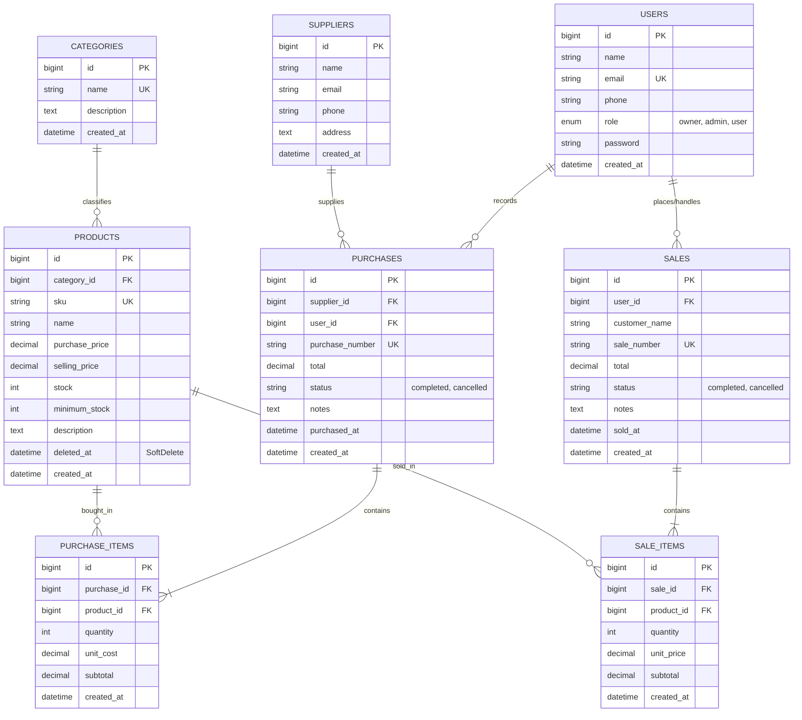

# INVENTA PRO — Integrated Inventory & Sales Management System
> **Mata Kuliah:** Web Programming  | **Evaluasi:** Ujian Tengah Semester (UTS)  
> **Teknologi:** Laravel 12/13, PHP 8.3+, MySQL, Tailwind CSS v4, Eloquent ORM, Pest Testing.

---

## 1. Project Overview
**Inventa Pro** adalah sistem manajemen inventaris dan transaksi penjualan/pembelian terintegrasi yang dibangun untuk mengatasi permasalahan pencatatan manual pada usaha distribusi. Sistem ini menjamin konsistensi stok secara atomik (`DB::transaction` & `Product::lockForUpdate`), mencegah *overselling*, mendukung multi-item per transaksi, dan memisahkan wewenang menjadi **3 peran (Role-Based Access Control)**:
1. **Owner (Pemilik Bisnis)**: Kendali penuh, manajemen akun & hak akses, laporan agregat bisnis, pembatalan transaksi dengan pemulihan stok.
2. **Staff / Admin (Operasional)**: Pengelolaan master data barang/kategori/supplier, pencatatan transaksi pembelian (*stock-in*), dan kasir penjualan (*stock-out*).
3. **User / Customer (Pelanggan Grosir)**: Akses e-katalog produk publik, pemesanan online mandiri, serta pencetakan riwayat faktur/nota pemesanan.

---

## 2. Requirements & Prasyarat Sistem
- **PHP:** >= 8.3 (dengan ekstensi `pdo_mysql`, `mbstring`, `openssl`, `tokenizer`, `xml`, `ctype`, `json`)
- **Composer:** >= 2.x
- **Basis Data:** MySQL 8.x / MariaDB 10.x (atau Laragon / XAMPP)
- **Node.js & NPM:** >= 18.x

---

## 3. Instalasi Langkah Demi Langkah (Reproducible Setup)

Ikuti langkah-langkah berikut untuk menjalankan aplikasi pada *environment* baru:

```bash
# 1. Clone repository
git clone <repository-url>
cd uts_web_sems3

# 2. Install dependensi PHP via Composer
composer install

# 3. Salin konfigurasi environment
cp .env.example .env

# 4. Generate application key
php artisan key:generate

# 5. Konfigurasi kredensial database MySQL di file .env
# Buka file .env dan sesuaikan:
# DB_CONNECTION=mysql
# DB_HOST=127.0.0.1
# DB_PORT=3306
# DB_DATABASE=uts_web_sems3
# DB_USERNAME=root
# DB_PASSWORD=

# 6. Buat database (jika belum ada) dan jalankan migration serta seeder otomatis
php artisan migrate --seed

# 7. Install dan bundle frontend asset
npm install
npm run build

# 8. Jalankan local development server
php artisan serve
```

Aplikasi dapat langsung diakses melalui browser pada: **`http://localhost:8000`**

---

## 4. Akun Demo (Demo Credentials)

Aplikasi telah dilengkapi seeder akun untuk ketiga tingkat peran:

| Peran (Role) | Email Login | Password | Akses & Wewenang Utama |
| :--- | :--- | :--- | :--- |
| **Owner** | `owner@example.com` | `password` | Kelola User/Role, Dashboard Keuangan, Batal Transaksi, Master Data, Transaksi |
| **Staff / Admin** | `admin@example.com` | `password` | Operasional Master Data, Transaksi Pembelian (*Stock-In*), Kasir (*Stock-Out*) |
| **User (Customer)** | `user@example.com` | `password` | Katalog Produk Online, Pemesanan Mandiri, Cetak Faktur Riwayat Pembelian |

> **Catatan:** Halaman login juga dilengkapi tombol **1-Click Quick Demo Login** untuk pengujian langsung tanpa perlu mengetik manual.

---

## 5. Entity Relationship Diagram (ERD) & Relasi Eloquent



### Penjelasan Relasi Eloquent:
- **`Category hasMany Product`** & **`Product belongsTo Category`**: Satu kategori dapat menaungi banyak produk. Foreign key `category_id` berada pada tabel `products`.
- **`Supplier hasMany Purchase`** & **`Purchase belongsTo Supplier`**: Pemasok menyediakan stok dalam banyak faktur pembelian.
- **`Purchase hasMany PurchaseItem`** & **`PurchaseItem belongsTo Purchase`**: Satu transaksi pengadaan menampung banyak jenis produk.
- **`Sale hasMany SaleItem`** & **`SaleItem belongsTo Sale`**: Satu transaksi penjualan menampung banyak baris produk kasir.
- **`Product hasMany PurchaseItem` & `Product hasMany SaleItem`**: Riwayat pergerakan stok masuk dan keluar dapat dilacak secara presisi per barang.
- **`Product` menggunakan `SoftDeletes`**: Mencegah *hard delete* jika produk pernah terlibat dalam transaksi penjualan/pembelian terdahulu untuk menjaga integritas data riwayat.

---

## 6. Fitur & Matriks Hak Akses (3 Roles Matrix)

| Modul & Aksi | Owner | Staff / Admin | User / Customer |
| :--- | :---: | :---: | :---: |
| **Login, Logout & Profil Akun** | ✅ | ✅ | ✅ |
| **Katalog Belanja Publik & Self-Checkout** | ✅ | ✅ | ✅ |
| **Riwayat Pesanan Mandiri & Cetak Nota** | ✅ | ✅ | ✅ |
| **Dashboard Metrik Agregat & Grafik Bisnis** | ✅ | ✅ | ❌ |
| **Alert Peringatan Produk Stok Rendah** | ✅ | ✅ | ❌ |
| **CRUD Kategori Produk** | ✅ | ✅ | ❌ |
| **CRUD Data Supplier & Kontak** | ✅ | ✅ | ❌ |
| **CRUD Produk Inventaris & Soft-delete** | ✅ | ✅ | ❌ |
| **Transaksi Pembelian Stok (Stock-In)** | ✅ | ✅ | ❌ |
| **Transaksi Kasir / POS (Stock-Out)** | ✅ | ✅ | ❌ |
| **Pencarian, Filter Tanggal, Status, Paginasi** | ✅ | ✅ | ❌ |
| **Cetak Faktur Resmi & Struk Pembelian** | ✅ | ✅ | ✅ |
| **Pembatalan Transaksi & Pemulihan Stok Konsisten** | ✅ | ❌ | ❌ |
| **Manajemen Pengguna & Pengaturan Peran (Role)** | ✅ | ❌ | ❌ |

---

## 7. Business Logic & Data Integrity
1. **Atomisitas Transaksi (`DB::transaction`)**: Seluruh operasi penulisan header faktur, item detail, dan perubahan stok dieksekusi secara atomik. Jika salah satu baris gagal atau stok tidak mencukupi, seluruh perubahan di-*rollback* seketika.
2. **Pencegahan Overselling & Race Conditions (`Product::lockForUpdate`)**: Sebelum pengurangan stok dilakukan, baris database produk dikunci secara pesimistik (*pessimistic lock*) sehingga dua transaksi bersamaan tidak akan menyebabkan stok menjadi minus (*double-spending*).
3. **Kalkulasi Server-Side Murni**: Harga satuan, subtotal, dan total tagihan selalu dihitung dan diverifikasi di *server* dari basis data aktif, bukan mempercayai input tersembunyi dari browser.
4. **Konsistensi Pembatalan Transaksi**: Fitur pembatalan faktur (khusus Owner) secara otomatis memulihkan stok: pembatalan *Sale* mengembalikan stok (`increment`), sedangkan pembatalan *Purchase* mengurangi stok (`decrement`) dengan validasi agar stok gudang tidak negatif.

---

## 8. Pengujian Otomatis (Automated Testing with Pest)

Aplikasi telah dilengkapi **15 test cases** komprehensif yang mencakup seluruh skenario wajib pada Slide 19:

```bash
php artisan test
```

### Hasil Uji Skenario Wajib (15 Passed, 45 Assertions):
1. **Auth:** Tamu dilarang membuka dashboard; password salah ditolak dengan pesan error; login valid berhasil.
2. **Product:** SKU kembar ditolak constraint & validasi; harga negatif ditolak.
3. **Purchase:** Transaksi pembelian berhasil menambah stok sesuai kuantitas secara akurat.
4. **Sale:** Transaksi penjualan berhasil mengurangi stok secara atomik.
5. **Insufficient Stock:** Transaksi dengan kuantitas > stok ditolak tanpa mengubah data sedikit pun.
6. **Atomicity:** Pada transaksi multi-item, kegagalan pada item kedua membatalkan seluruh transaksi (*full rollback*).
7. **Authorization:** Staff dilarang membuka `/users`; User dilarang membuka `/dashboard`; hanya Owner yang dapat membatalkan transaksi.
8. **Search & Filter:** Pencarian SKU/nama dan filter stok rendah menghasilkan data yang akurat.

---

## 9. Panduan Menjawab Code Ownership Interview (Slide 24)

Berikut rangkuman jawaban teknis untuk pertanyaan wawancara dosen:

1. **Mengapa `Sale` memiliki relasi `hasMany` ke `SaleItem`?**  
   *Jawaban:* Karena sebuah transaksi penjualan dapat terdiri dari banyak item barang berbeda (multi-item). Struktur *One-to-Many* ini memisahkan data transaksi umum (header: nomor nota, tanggal, pelanggan, kasir) dengan rincian per barang (detail: kuantitas, harga pada saat transaksi, subtotal), memenuhi kaidah normalisasi basis data (3NF).
2. **Di mana sistem memastikan stok tidak menjadi negatif?**  
   *Jawaban:* Pada level *business logic* controller (`SaleController@store`) sebelum eksekusi pemotongan stok, terdapat pengecekan eksplisit:  
   `if ($qty < 1 || $product->stock < $qty) { throw ValidationException::withMessages(...); }`.  
   Selain itu, basis data dilindungi dengan tipe data *unsigned integer* dan pesimistik lock.
3. **Mengapa total penjualan dihitung di server?**  
   *Jawaban:* Untuk alasan keamanan (*security & integrity*). Input dari sisi browser (HTML/JS) dapat dimanipulasi melalui Inspect Element atau tools seperti Postman. Dengan mengambil harga resmi langsung dari database dan mengalikannya di server, integritas nilai keuangan terjamin 100%.
4. **Apa risiko jika pengurangan stok dilakukan di luar `DB::transaction`?**  
   *Jawaban:* Risiko inkonsistensi data (*partial failure*). Jika header atau item ke-1 tersimpan lalu koneksi database terputus atau item ke-2 error, data akan tersimpan setengah-setengah (*orphan data*) dan stok tidak sesuai dengan faktur riil. `DB::transaction` menjamin prinsip ACID (semua tersimpan atau semua dibatalkan).
5. **Bagaimana mencegah Staff/User mengakses fungsi Admin/Owner melalui URL langsung?**  
   *Jawaban:* Dengan perlindungan lapis ganda di sisi server: Middleware `EnsureRole` (`role:owner`, `role:owner,admin`) pada `routes/web.php` dan otorisasi Laravel Gate (`Gate::allows(...)`). Memasukkan URL secara langsung akan memicu respon `HTTP 403 Forbidden` di server.
6. **Apa yang terjadi jika dua penjualan memproses stok produk yang sama hampir bersamaan?**  
   *Jawaban:* Dihindari menggunakan `Product::lockForUpdate()->findOrFail($id)`. Transaksi kedua akan menunggu (*wait*) hingga transaksi pertama selesai (`commit`), sehingga stok yang dibaca transaksi kedua selalu yang paling mutakhir. Jika sisa stok tidak cukup setelah transaksi pertama selesai, transaksi kedua akan otomatis ditolak.
7. **Tunjukkan validasi SKU unik dan jelaskan peran constraint database.**  
   *Jawaban:* Validasi dilakukan pada form request controller (`'sku' => ['required', 'unique:products,sku']`) untuk memberikan pesan kesalahan ramah pengguna. Di level basis data, kolom SKU didefinisikan dengan `$table->string('sku')->unique()`, sehingga mesin database MySQL secara absolut menolak duplikasi bahkan saat terjadi *race condition*.
8. **Ubah aturan minimum stock dan tunjukkan dampaknya.**  
   *Jawaban:* Aturan minimum stock tersimpan pada kolom `products.minimum_stock`. Pada helper method `Product::isLowStock()`, sistem mengevaluasi `$this->stock <= $this->minimum_stock`. Jika nilai minimum dinaikkan (misal dari 5 menjadi 20), barang dengan stok 15 yang tadinya berstatus aman akan langsung masuk ke daftar **Peringatan Stok Rendah** pada Dashboard dan terpicu di filter pencarian.

---

## 10. Known Limitations
- Pembayaran dicatat secara tunai/lunas langsung pada kasir (*cash/term* sederhana), belum terintegrasi dengan Payment Gateway pihak ketiga (Midtrans/Xendit) sesuai batasan tugas pada Slide 4.
- Manajemen pergudangan disederhanakan untuk usaha distribusi satu titik gudang (*single warehouse*).
